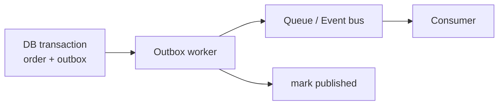

# Distributed Systems

## 1. Vì sao consumer bắt buộc phải idempotent?

Các hệ thống message phổ biến (SQS, SNS, Kafka, EventBridge) không đảm bảo "exactly once" trong thực tế; chúng nghiêng về **at-least-once**. Message có thể được giao lại vì nhiều lý do: consumer timeout trước khi ack, visibility timeout hết hạn, network lỗi giữa chừng, hoặc retry do batch failure.

Kịch bản kinh điển:

```text
SQS -> Lambda -> charge(payment)
```

Lambda đã charge thành công nhưng bị timeout trước khi xoá message. Queue coi như thất bại và giao lại. Consumer chạy lần hai và charge lần hai. Khách bị trừ tiền hai lần — lỗi không thể sửa bằng cách "code cẩn thận hơn", vì bản thân thông điệp đã đến hai lần.

Cách xử lý là làm cho việc xử lý **có thể lặp lại mà không đổi kết quả**. Pattern phổ biến:

```sql
BEGIN;

INSERT INTO processed_events (event_id, result, processed_at)
VALUES (?, ?, now())
ON CONFLICT (event_id) DO NOTHING;

-- nếu insert không thêm dòng nào => đã xử lý trước đó, đọc result và trả về

COMMIT;
```

Điều kiện để idempotency hoạt động đúng:

- Khoá phải ổn định giữa các lần giao (event id do producer sinh, không phải timestamp xử lý).
- Bản ghi "đã xử lý" và thay đổi nghiệp vụ phải nằm **cùng transaction**, nếu không sẽ có khoảng hở: ghi nhận đã xử lý nhưng nghiệp vụ chưa commit, hoặc ngược lại.
- Với payment, idempotency key nên được gửi xuống cả payment provider để phía đối tác cũng chống trùng.

Idempotency không phải chi tiết của riêng consumer; nó là thuộc tính cần thiết của mọi thao tác có side effect khi đi qua network: tạo order, gửi email, trừ kho, gọi API bên thứ ba.

## 2. Retry nên được thiết kế như thế nào?

Retry ngây thơ — lỗi thì gọi lại ngay — biến một sự cố cục bộ thành sự cố toàn hệ thống. Nếu downstream đang quá tải, 1000 request nhân 3 lần retry thành 3000 request, đúng lúc nó yếu nhất.

Ba yếu tố cần có:

**Exponential backoff**: khoảng chờ tăng dần theo số lần thử, ví dụ 1s, 2s, 4s, 8s, có giới hạn trần. Điều này cho downstream thời gian hồi phục và giảm áp lực.

**Jitter**: cộng thêm độ trễ ngẫu nhiên. Nếu không có jitter, tất cả client cùng retry tại cùng thời điểm và tạo ra các cơn sóng tải đều đặn — hiện tượng thundering herd.

**Phân loại lỗi**: chỉ retry lỗi có khả năng tự khỏi.

- Nên retry: timeout, lỗi mạng, 429, 500/502/503, deadlock trong database.
- Không nên retry: 400 do dữ liệu sai, 401/403, lỗi validation, thẻ bị từ chối. Retry chỉ tốn tài nguyên và có thể gây hại (ví dụ trừ tiền nhiều lần nếu lỗi là "thẻ bị từ chối").

Ngoài ra cần giới hạn tổng số lần thử và có hành động sau khi hết: đưa vào DLQ, trả lỗi cho người dùng, hoặc chuyển trạng thái "cần xử lý thủ công". Retry vô hạn không phải là giải pháp, nó chỉ là cách trì hoãn việc quyết định.

Với queue, retry nên được cấu hình ở tầng hạ tầng (visibility timeout, maxReceiveCount) chứ không chỉ ở code, để message độc hại không quay vòng mãi trong hệ thống.

## 3. Circuit Breaker dùng để làm gì?

Circuit breaker bảo vệ hệ thống khỏi **cascading failure** — một dependency chết kéo theo toàn bộ các service gọi nó.

Tình huống: `Order` gọi `Payment`, Payment đang down. Nếu Order vẫn gửi hàng nghìn request, mỗi request giữ một connection và chờ tới timeout, thread/socket của Order cạn dần, rồi Order cũng chết theo dù bản thân nó khoẻ.

Ba trạng thái:

- **CLOSED**: hoạt động bình thường, đếm lỗi.
- **OPEN**: sau khi vượt ngưỡng lỗi, mọi lời gọi bị từ chối ngay lập tức, không chờ timeout.
- **HALF-OPEN**: sau một khoảng chờ, cho một lượng nhỏ request thử đi qua. Thành công thì đóng lại, thất bại thì mở tiếp.

Giá trị chính không phải "tránh lỗi" — dependency chết thì vẫn lỗi — mà là **fail nhanh**, giải phóng tài nguyên, và cho dependency đang hồi phục không bị đánh sập lần nữa.

Cần kèm theo fallback hợp lý: trả kết quả cache, xếp hàng chờ xử lý sau, hoặc báo lỗi rõ ràng cho người dùng. Circuit breaker không có fallback thì chỉ chuyển từ timeout sang lỗi tức thì.

## 4. Transactional Outbox giải quyết vấn đề gì?

Vấn đề gốc: database và message broker là hai hệ thống khác nhau, không có transaction chung.

```javascript
await db.order.create(order);       // commit thành công
await sqs.sendMessage({ type: 'OrderCreated' });   // crash ở đây
```

Database có order, nhưng downstream (email, inventory, analytics) không bao giờ biết. Đảo thứ tự cũng sai: publish trước rồi DB fail thì downstream nhận event về một order không tồn tại.

Không thể giải quyết bằng try/catch hay retry đơn thuần vì khoảng hở nằm giữa hai lần commit.

Outbox pattern:

```text
BEGIN
  INSERT INTO orders ...
  INSERT INTO outbox (event_type, payload, status)
COMMIT
```

Order và event được ghi trong **cùng một transaction**, nên hoặc cả hai tồn tại, hoặc không cái nào. Một worker riêng đọc bảng outbox, publish lên broker, rồi đánh dấu đã gửi:



Các điểm cần xử lý khi triển khai:

- Worker publish xong nhưng crash trước khi mark → event được gửi lại. Vì vậy consumer vẫn phải idempotent; outbox chỉ đảm bảo **không mất event**, không đảm bảo không trùng.
- Thứ tự: đọc outbox theo thứ tự tăng dần của id, publish tuần tự trong một partition/key nếu cần ordering.
- Dọn dữ liệu: bảng outbox phải có retention, nếu không sẽ phình rất nhanh.
- Với hệ thống lớn, dùng CDC (Debezium) đọc binlog thay vì worker polling để giảm tải database.

## 5. Saga là gì và chọn choreography hay orchestration?

Khi một nghiệp vụ trải qua nhiều service với database riêng, không có ACID transaction xuyên service. Saga chia giao dịch lớn thành chuỗi **local transaction**, và khi một bước thất bại thì chạy các **compensating transaction** để hoàn tác logic.

Ví dụ luồng đặt hàng:

```text
Tạo order -> Giữ tồn kho -> Trừ tiền -> Xác nhận order
```

Nếu trừ tiền thất bại: nhả tồn kho, huỷ order. Lưu ý compensating transaction không phải rollback thật — nó là một hành động nghiệp vụ mới (ví dụ hoàn tiền), nên phải được thiết kế cẩn thận và cũng cần idempotent.

Hai cách triển khai:

**Choreography** — các service phản ứng với event của nhau, không có bộ điều phối trung tâm.

- Ưu: coupling lỏng, dễ thêm consumer mới.
- Nhược: khi luồng có 5-6 bước, không ai nhìn được toàn cảnh; debug khó; dễ sinh vòng event.

**Orchestration** — một orchestrator gọi tuần tự các service và biết trạng thái của cả saga.

- Ưu: luồng nằm một chỗ, dễ quan sát, dễ xử lý timeout và bù trừ.
- Nhược: orchestrator thành điểm phức tạp và phụ thuộc trung tâm; cần lưu state của saga bền vững.

Chọn theo độ phức tạp: 2-3 bước đơn giản thì choreography đủ; luồng nhiều bước, nhiều nhánh lỗi, cần audit và can thiệp thủ công thì orchestration đáng làm. Trong cả hai trường hợp, cần lưu trạng thái saga để có thể phục hồi khi process chết giữa chừng — saga không tự khỏi nếu không ai theo dõi nó.
