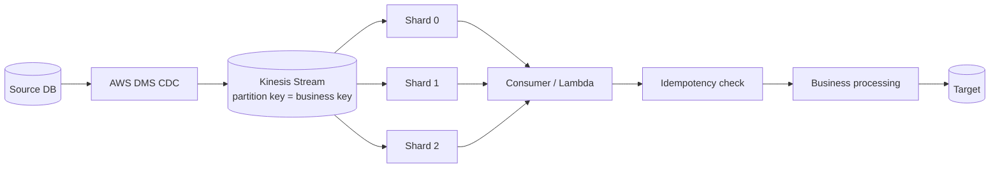

# Message Ordering và Kinesis

## 1. Kinesis chỉ đảm bảo thứ tự trong một shard

Kinesis Data Stream chia thành các shard; mỗi record được gán vào một shard dựa trên **partition key** (băm key rồi chia lấy dư). Thứ tự được đảm bảo **bên trong shard**, không phải trên toàn stream.

Hệ quả trực tiếp: thiết kế partition key chính là thiết kế mức ordering bạn nhận được. Đây là điểm cần xác định trước khi bàn tới consumer.

Với luồng CDC `Database → AWS DMS → Kinesis → Consumer`, DMS cho phép chọn cách sinh partition key. Ba chế độ thường dùng:

- `constant`: mọi record cùng một key → thứ tự toàn cục.
- `primary-key` (hoặc một cột cụ thể): thứ tự theo entity.
- `transaction-id`: các record của cùng transaction đi cùng nhau.

## 2. Tuần tự toàn cục: partition key hằng số

Nếu bắt buộc consumer phải thấy đúng thứ tự của mọi thay đổi trên toàn database:

```json
"mapping-parameters": { "partition-key-type": "constant" }
```

Tất cả record dùng cùng key nên hash về cùng một shard:

```text
event1 ┐
event2 ├─ key "constant" → shard X → 1, 2, 3, 4
event3 ┘
```

Với Lambda consumer, record trong một shard được xử lý theo thứ tự; để dễ suy luận, giữ `ParallelizationFactor = 1` (mặc định).

Cái giá rất lớn: dù stream có 10 shard, mọi record dồn vào một shard. Scale ngang gần như mất tác dụng, và shard đó trở thành điểm nghẽn cả về throughput lẫn xử lý.

## 3. Tuần tự theo entity: mặc định nên chọn

Phần lớn hệ thống chỉ cần "các thay đổi của cùng một order đúng thứ tự", không cần toàn database tuần tự.

```json
"mapping-parameters": { "partition-key-type": "primary-key" }
```

hoặc dùng một cột nghiệp vụ (ví dụ `order_id`) làm key. Kết quả:

```text
order 100 → shard 1: INSERT → PAID → SHIPPED
order 200 → shard 3: INSERT → PAID
order 300 → shard 2: ...
```

Được cả hai: ordering trong từng entity và song song giữa các entity.

Đây là lựa chọn mặc định cho: User, Order, Payment, Product, Subscription, Device, Account. Đặc biệt phù hợp khi downstream là projection, Elasticsearch, cache, materialized view hoặc đồng bộ sang service khác — nơi điều quan trọng là trạng thái cuối cùng của từng đối tượng.

## 4. Tuần tự theo transaction: khi transaction boundary có ý nghĩa nghiệp vụ

Có những trường hợp consumer cần biết "các thay đổi này thuộc cùng một transaction và phải xét cùng nhau".

```json
"mapping-parameters": { "partition-key-type": "transaction-id" }
```

Tất cả record của một transaction vào cùng partition. Nếu bật thêm:

```json
{ "IncludeTransactionDetails": true }
```

message có metadata như `transaction_id`, `transaction_record_id`, commit timestamp, log position. `transaction_record_id` cho biết vị trí record trong transaction, nhờ đó consumer có thể gom đủ record trước khi áp dụng.

Điểm cực kỳ dễ hiểu nhầm: `transaction-id` **không** đảm bảo thứ tự giữa các transaction. TX1 và TX2 có thể vào hai shard khác nhau. Vì vậy nó **không** giữ được lifecycle của một entity trải qua nhiều transaction:

```text
TX1 (order 100 → PAID)     → shard 1
TX2 (order 100 → SHIPPED)  → shard 3
```

Consumer có thể thấy SHIPPED trước PAID nếu shard 3 xử lý nhanh hơn. Nếu mục tiêu là lifecycle của order, phải dùng entity ordering.

## 5. Chọn entity hay transaction?

Câu hỏi đúng không phải "cái nào tốt hơn" mà là **đơn vị consistency của downstream là gì**.

| Yêu cầu | Entity | Transaction |
|---|---|---|
| Giữ đúng lifecycle của Order/User | Phù hợp | Không |
| Cùng entity qua nhiều transaction | Phù hợp | Không |
| Gom nhiều bảng trong một DB transaction | Không | Phù hợp |
| Rebuild một transaction nguyên tử downstream | Không | Phù hợp |
| Đồng bộ Elasticsearch/cache | Phù hợp | Không |
| Audit/reconciliation theo transaction | Có thể | Phù hợp |
| Scale song song | Tốt | Tốt |

Rule thực dụng: nếu chưa có yêu cầu rõ ràng về việc reconstruct database transaction, dùng entity ordering. `transaction-id` chỉ dùng khi transaction boundary thực sự là một phần semantics của hệ thống downstream, không phải vì source database vốn dùng transaction.

Có thể kết hợp cả hai: partition theo `order_id` và bật `IncludeTransactionDetails` để vẫn có metadata transaction. Khi đó có entity ordering và thông tin transaction, không phải hy sinh điều nào.

## 6. Use case cần transaction ordering: sổ cái kế toán

Một giao dịch chuyển 1.000.000đ từ A sang B gồm nhiều thay đổi trong một transaction:

```sql
BEGIN;
INSERT INTO transfers (id, from_account, to_account, amount) VALUES ('TX100','A','B',1000000);
INSERT INTO ledger_entries VALUES ('TX100','A','DEBIT',1000000);
INSERT INTO ledger_entries VALUES ('TX100','B','CREDIT',1000000);
UPDATE accounts SET balance = balance - 1000000 WHERE id = 'A';
UPDATE accounts SET balance = balance + 1000000 WHERE id = 'B';
COMMIT;
```

Nếu partition theo `account_id`, năm thay đổi này đi ba hướng khác nhau. Downstream có thể thấy B được cộng tiền trước khi A bị trừ — tạm thời tổng tiền hệ thống là 16M thay vì 15M. Với search index thì không sao; với ledger, risk engine, fraud detection, đối soát hoặc báo cáo tài chính thì không chấp nhận được.

Partition theo `transaction_id` giữ cả năm record trong một shard, consumer có thể gom đủ rồi mới áp dụng:

```text
gom record theo TX100 → kiểm tra bất biến Debit = Credit → apply như một đơn vị
```

Lưu ý: transaction ordering **không phải atomicity**. Nó chỉ đảm bảo các record cùng transaction nằm cùng một ordering domain; muốn "hoặc tất cả hoặc không gì" thì consumer vẫn phải tự gom transaction, phát hiện đã đủ record, deduplicate, rồi ghi downstream trong một transaction.

Cách nhớ:

- Entity ordering trả lời: "lịch sử của Account A có đúng thứ tự không?"
- Transaction ordering trả lời: "các thay đổi tạo nên TX100 có được giữ cùng nhau không?"

Với ledger, một giao dịch tác động nhiều entity cùng lúc nên transaction ordering có lợi thế rõ ràng.

## 7. Ordering không đồng nghĩa exactly-once

DMS + Kinesis + Lambda thực tế nên được thiết kế theo **at-least-once**:

- Kinesis không tự deduplicate record.
- Lambda event source mapping có thể xử lý cùng một record nhiều hơn một lần.
- Consumer xử lý thành công nhưng crash trước khi checkpoint → record được giao lại.

Vì vậy consumer phải idempotent, dùng `transaction_id` + `transaction_record_id` hoặc event id làm khoá:

```text
processed_event(transaction_id, transaction_record_id)
```

và lý tưởng nhất là gộp kiểm tra + áp dụng thay đổi vào cùng một transaction ở database đích, thay vì hai bước tách rời.

## 8. Lỗi giữa batch: dừng đúng chỗ

Giả sử batch `[seq 100, 101, 102, 103]`, trong đó 102 lỗi. Với yêu cầu ordering nghiêm ngặt, **không được tiếp tục xử lý 103** — nếu tiếp tục, trạng thái business có thể lệch và khi retry 102 sẽ áp dụng lên dữ liệu đã đi trước.

Đúng:

```text
100 ✓ → 101 ✓ → 102 ✗ → dừng → retry từ 102 → 102 ✓ → tiếp 103
```

Lambda hỗ trợ `ReportBatchItemFailures`; khi trả về nhiều failure, checkpoint được tính theo sequence number thấp nhất cần retry:

```javascript
for (const record of event.Records) {
  try {
    await process(record);
  } catch (error) {
    return {
      batchItemFailures: [{ itemIdentifier: record.kinesis.sequenceNumber }],
    };
  }
}
return { batchItemFailures: [] };
```

Lưu ý: nếu handler crash (OOM, timeout) thì không có partial response, cả batch bị coi là thất bại. Kích thước batch và thời gian xử lý phải được chọn theo khả năng thật của handler.

## 9. Kiến trúc tham khảo cho DMS → Kinesis



Chọn key theo loại dữ liệu: `orders → order_id`, `users → user_id`, `payments → payment_id`. Với bảng audit/ledger, dùng `transaction-id` (kèm transaction details). Không chọn `constant` trừ khi thật sự cần thứ tự toàn cục, vì nó biến stream nhiều shard thành một luồng tuần tự.

Một điểm cần kiểm tra khi dùng DMS: `PutRecords` thông thường không đảm bảo ordering như `PutRecord`, nên với producer là DMS hãy dựa vào các chế độ partition key do DMS hỗ trợ thay vì suy luận từ một custom producer.
