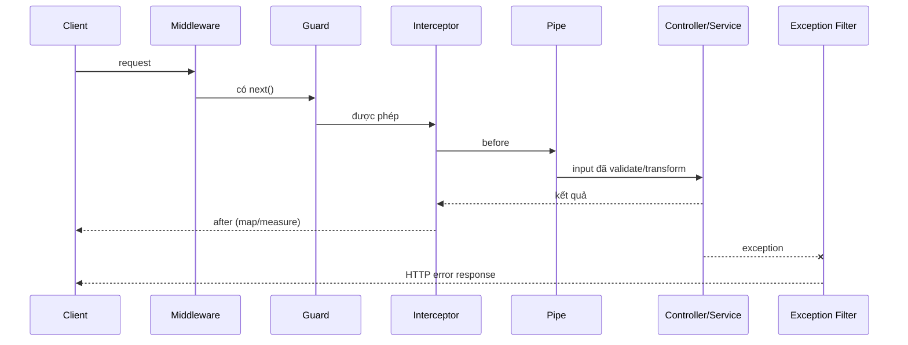

# NestJS và Kiến trúc Backend

## 1. Tổ chức một ứng dụng NestJS lớn như thế nào?

Câu hỏi không nhằm kiểm tra bạn thuộc `@Controller()` để làm gì, mà để xem bạn có tách được **transport concern**, **business logic** và **persistence** hay không.

Với module nhỏ, một controller gọi thẳng một service là đủ và không cần làm phức tạp. Vấn đề xuất hiện khi module có nhiều nhánh nghiệp vụ, nhiều nguồn dữ liệu, và cần test độc lập:

```text
modules/
  order/
    presentation/
      order.controller.ts
    application/
      create-order.usecase.ts
      cancel-order.usecase.ts
    domain/
      order.entity.ts
      order.repository.ts        // interface
    infrastructure/
      postgres-order.repository.ts
```

Vai trò từng lớp:

- **Controller**: nhận HTTP, chuyển sang command/DTO, trả response hoặc lỗi. Không biết SQL, không biết nghiệp vụ.
- **Use case** (application service): điều phối một hành động nghiệp vụ cụ thể, quản lý transaction boundary, gọi repository và service khác.
- **Domain**: entity, value object, rule nghiệp vụ thuần, không phụ thuộc framework.
- **Repository**: interface ở domain, implementation ở infrastructure. Nhờ vậy use case test được bằng in-memory repository.

Điểm quan trọng hơn cả việc chia thư mục là **chiều phụ thuộc**: domain không import infrastructure, application không import controller. Nếu chiều này bị đảo, việc thay đổi ORM hay transport sẽ lan ra toàn bộ codebase.

Với hệ thống nhỏ, có thể bỏ lớp use case và để service đảm nhận; nhưng khi business logic bắt đầu gọi nhiều repository, nhiều module và cần transaction, tách use case giúp ranh giới rõ ràng.

## 2. Middleware, Guard, Pipe, Interceptor và Exception Filter khác nhau ở đâu?

Chúng nằm ở các vị trí khác nhau trong vòng đời request, và mỗi thứ giải quyết một loại concern riêng:



- **Middleware** chạy sớm nhất, không có access vào handler metadata theo cách của Nest. Phù hợp: logging thô, gắn correlation ID, xử lý body/header ở mức HTTP. Về bản chất là Express middleware.
- **Guard** trả lời câu hỏi "request này có được đi tiếp không". Đây là nơi đặt authentication/authorization, kiểm tra role, kiểm tra tenant. Guard chạy trước pipe nên chặn được request trước khi tốn công validate.
- **Pipe** biến đổi và validate input: `ParseIntPipe`, `ValidationPipe` với class-validator. Pipe chạy sau guard, trước khi vào handler.
- **Interceptor** bao quanh việc thực thi handler (before/after), dùng cho logging có timing, map response, cache, hoặc biến đổi kết quả bằng RxJS operator.
- **Exception Filter** bắt exception chưa được xử lý và biến thành response HTTP có cấu trúc. Dùng để chuẩn hoá error format và tránh lộ stack trace.

Ví dụ pipe:

```typescript
@Get(':id')
find(@Param('id', ParseIntPipe) id: number) {
  return this.orderService.findById(id);
}
```

Lỗi thường gặp: đặt authorization trong middleware (không truy cập được handler metadata, khó test), hoặc đặt validation trong controller (lặp lại ở mọi route). Chọn đúng tầng giúp code ngắn hơn và nhất quán hơn.

## 3. Có nên đặt business logic trong Controller?

Thông thường là không.

```typescript
@Post()
async createOrder(@Body() dto: CreateOrderDto) {
  const product = await this.prisma.product.findUnique({ where: { id: dto.productId } });
  if (!product || product.stock <= 0) throw new BadRequestException();
  await this.prisma.product.update({ where: { id: dto.productId }, data: { stock: { decrement: 1 } } });
  return this.prisma.order.create({ data: dto });
}
```

Controller ở đây đang làm bốn việc: parse HTTP, kiểm tra nghiệp vụ, thao tác dữ liệu, và tạo response. Hệ quả:

- Không test được rule "không bán khi hết hàng" mà không dựng HTTP context.
- Không tái sử dụng được khi cùng hành động được gọi từ queue consumer hoặc cron job.
- Không đặt được transaction boundary hợp lý khi có thêm bước thanh toán.
- Mỗi lần đổi transport (HTTP → gRPC → message) phải viết lại logic.

Cách tách:

```typescript
@Post()
create(@Body() dto: CreateOrderDto) {
  return this.createOrder.execute(dto);   // use case
}
```

Controller chỉ còn nhiệm vụ chuyển đổi giữa HTTP và application layer. Đây không phải quy tắc tuyệt đối cho mọi CRUD đơn giản, nhưng là mặc định đúng khi logic bắt đầu có điều kiện nghiệp vụ.

## 4. Service của module này có nên gọi trực tiếp service của module khác?

Có thể, và trong nhiều trường hợp nên như vậy.

Vấn đề không phải là "gọi trực tiếp thì xấu", mà là **hướng phụ thuộc và độ sâu của chuỗi gọi**. Nếu `OrderService` gọi `InventoryService`, `InventoryService` gọi `PaymentService`, `PaymentService` gọi `NotificationService`, dependency graph sẽ phình ra và mọi thay đổi lan truyền.

Nguyên tắc thực dụng:

- Cần kết quả **ngay trong request** để quyết định (ví dụ kiểm tra tồn kho trước khi tạo order): gọi đồng bộ là lựa chọn đúng, event chỉ làm phức tạp thêm.
- Việc **không ảnh hưởng kết quả trả về** (gửi email, ghi analytics, audit, thông báo): đẩy sang event/queue để giảm coupling và tránh làm chậm request.
- Phụ thuộc nên đi một chiều và đi qua interface do module cung cấp (export service hoặc token), không import chéo repository của nhau.

Không nên biến mọi lời gọi thành event chỉ vì "event-driven nghe chuyên nghiệp hơn". Event kéo theo eventual consistency, khó debug luồng, khó đảm bảo thứ tự — cái giá đó chỉ đáng trả khi yêu cầu thật sự cần.

## 5. Circular dependency trong NestJS nói lên điều gì?

Ví dụ `OrderService` cần `PaymentService`, và `PaymentService` lại cần `OrderService` để cập nhật trạng thái.

```typescript
@Injectable()
export class OrderService {
  constructor(@Inject(forwardRef(() => PaymentService)) private payment: PaymentService) {}
}
```

`forwardRef()` giải quyết vấn đề **dependency injection**, không giải quyết vấn đề **thiết kế**. Nó chỉ hoãn việc resolve để cả hai class cùng tồn tại. Hệ quả thường gặp: khởi tạo không xác định, khó test, khó suy luận luồng chạy, và dễ sinh vòng lặp gọi vô hạn lúc runtime.

Vòng phụ thuộc thường phản ánh một trong các vấn đề:

- Hai module đang chia sẻ cùng một khái niệm nghiệp vụ nhưng bị cắt sai chỗ.
- Một service đang gánh quá nhiều trách nhiệm.
- Logic điều phối nên nằm ở lớp thứ ba thay vì nằm trong một trong hai service.

Cách sửa phổ biến: đưa phần điều phối lên một coordinator/use case (`CheckoutCoordinator` gọi cả hai), hoặc đảo chiều phụ thuộc bằng domain event. `forwardRef()` chấp nhận được khi số lượng rất ít và có lý do rõ ràng; nếu xuất hiện nhiều, đó là tín hiệu cần xem lại ranh giới module.

## 6. Provider scope, dynamic module và quản lý config cần lưu ý gì?

**Provider scope** ảnh hưởng trực tiếp tới hiệu năng:

- `DEFAULT` (singleton): một instance cho cả app. Đây là mặc định và nên là lựa chọn cho gần như mọi service.
- `REQUEST`: instance mới cho mỗi request. Chỉ dùng khi thật sự cần dữ liệu theo request (user context, tenant). Cái giá: cấp phát theo request và **lan truyền ngược lên** — bất kỳ provider nào inject nó cũng trở thành request-scoped.
- `TRANSIENT`: instance riêng cho từng consumer, dùng cho thứ có state nội bộ riêng biệt.

**Dynamic module** dùng khi module cần cấu hình lúc import, ví dụ `forRoot()`/`forRootAsync()` kết nối database hoặc đọc secret. Đây là cách giữ cấu hình tập trung và tránh `process.env` rải khắp code.

**Config**: dùng `ConfigModule` với schema validation (Joi/zod) để app fail fast khi thiếu biến môi trường, thay vì lỗi mơ hồ ở request đầu tiên. Secret thật (API key, DB password) nên lấy từ secret manager, không commit vào repo và không log ra.

Phần kiến trúc tổng thể — chọn modular monolith hay microservices, ranh giới module, transaction xuyên module — nằm ở `backend/modular-monolith.md` và `backend/microservices.md`.
