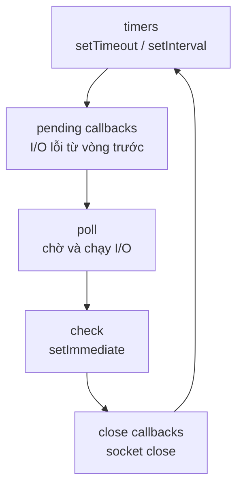

# Node.js Runtime

## 1. Vì sao Node.js single-thread mà vẫn xử lý được hàng nghìn request đồng thời?

Node.js chỉ dùng một main thread cho phần JavaScript, nhưng "single-thread" ở đây chỉ nói về việc **thực thi code JS**, không nói về toàn bộ công việc của process.

Cần tách hai khái niệm:

- **Concurrency**: nhiều tác vụ cùng tiến triển trong một khoảng thời gian, có thể chồng chéo nhau.
- **Parallelism**: nhiều tác vụ thực sự chạy cùng lúc trên nhiều core.

Node.js đạt concurrency bằng cách không chờ I/O. Khi handler gặp `await db.query(...)`, engine đăng ký phần tiếp theo của hàm như một callback, rồi trả quyền điều khiển về event loop. Thread JS lập tức rảnh để nhận request khác. Khi database trả kết quả, callback được xếp vào hàng đợi và chạy tiếp.

Phần I/O đó chạy ở đâu?

- Socket mạng, kết nối TCP/HTTP: do OS xử lý, libuv nhận thông báo sự kiện (`epoll` trên Linux, `kqueue` trên macOS).
- Việc hệ thống không có cơ chế chờ sự kiện — đọc/ghi file, `dns.lookup`, `crypto`, `zlib` — được đẩy xuống **libuv thread pool** (mặc định 4 thread, đổi bằng `UV_THREADPOOL_SIZE`). Đây là lý do 5 request đọc file lớn cùng lúc vẫn có thể xếp hàng chờ nhau.

Mô hình vỡ khi main thread bị chiếm bởi công việc CPU:

```javascript
app.get('/report', (req, res) => {
  let sum = 0;
  for (let i = 0; i < 10_000_000_000; i++) sum += i;
  res.send(sum);
});
```

Trong suốt vòng lặp đó, event loop không chạy được phase nào: request mới không được accept, timer trễ, promise callback không được thực thi, health check timeout. Đây là **event-loop blocking**, và nó khác hoàn toàn với "server quá tải vì nhiều request".

Cách xử lý theo bản chất workload:

- **I/O-bound** (DB, HTTP, Redis, S3): để nguyên trên event loop, tăng concurrency bằng async đúng cách.
- **CPU-bound** (xử lý ảnh, nén, mã hoá, biến đổi JSON lớn, tính toán nặng): đẩy sang worker thread, process riêng, queue + worker, hoặc một service/Lambda chuyên dụng.

Dấu hiệu nhận biết trên production: CPU chỉ đạt khoảng 1 core nhưng P99 latency tăng vọt, event loop lag tăng, throughput giảm dù không tăng traffic. Đo bằng `perf_hooks.monitorEventLoopDelay()` hoặc metric event loop lag của APM.

## 2. Event loop chạy theo thứ tự nào?

Event loop là vòng lặp gồm các phase cố định. Sau mỗi phase (và giữa các callback), Node dọn hai hàng đợi vi mô: `process.nextTick` trước, rồi promise microtask.



Ví dụ kinh điển:

```javascript
console.log('A');
setTimeout(() => console.log('B'), 0);
Promise.resolve().then(() => console.log('C'));
console.log('D');
```

Kết quả `A D C B`: code đồng bộ chạy hết trước, sau đó microtask, cuối cùng mới tới phase timers.

Danh sách đầy đủ thường được nhắc là sáu phase: timers, pending callbacks, idle/prepare (nội bộ libuv, không có callback của người dùng), poll, check, close callbacks. Từ Node.js 20 với libuv 1.45, timer được xử lý sau poll trong mỗi vòng thay vì trước và sau poll như các bản cũ, nên sơ đồ trên là mô hình để suy luận về thứ tự tương đối, không phải lịch tuyệt đối cho mọi phiên bản.

Điểm cần nắm chứ không phải học thuộc tên phase:

- Callback đồng bộ và callback bất đồng bộ không chen ngang nhau; mỗi lần event loop quay lại phase là một "lượt" mới.
- `setTimeout(fn, 0)` không có nghĩa là chạy ngay; nó chạy ở phase timers của vòng kế tiếp, sau khi các microtask hiện tại xong.
- Nếu một phase có nhiều callback, chúng chạy lần lượt; một callback chậm làm trễ toàn bộ phần còn lại.

## 3. `process.nextTick`, promise microtask và `setImmediate` khác nhau ở đâu?

Ba thứ này thường bị gộp thành "async" nhưng nằm ở ba vị trí khác nhau:

| Cơ chế | Chạy khi nào | Hệ quả |
|---|---|---|
| `process.nextTick` | Ngay sau khi operation hiện tại kết thúc, **trước** khi event loop sang phase kế | Ưu tiên cao nhất; lạm dụng sẽ làm đói I/O |
| Promise `.then` / `await` | Microtask queue, sau khi nextTick queue rỗng | Chạy trước khi event loop tiếp tục |
| `setImmediate` | Phase check, sau poll | Nhường I/O của vòng hiện tại chạy trước |

`process.nextTick` hữu ích khi cần đảm bảo một callback chạy sau khi hàm hiện tại trả về nhưng trước khi bất kỳ I/O nào khác chen vào — ví dụ emit lỗi sau khi constructor hoàn tất, hoặc cleanup nội bộ của thư viện.

Rủi ro: nếu trong nextTick lại gọi nextTick vô hạn, event loop không bao giờ tới phase poll, I/O đói hoàn toàn. Tương tự với chuỗi promise tự sinh vô hạn. Đây là lý do các API mới thường dùng `queueMicrotask` hoặc `setImmediate` thay vì nextTick.

Một chi tiết dễ gây nhầm: `process.nextTick` **không phải** một phase của event loop. Nó là hàng đợi riêng được xử lý ngay sau đoạn JavaScript hiện tại, trước cả promise microtask. Thứ tự tương đối giữa nextTick và promise cũng phụ thuộc ngữ cảnh thực thi (CommonJS so với ES module), nên không nên xây logic production dựa vào việc đoán thứ tự này; chỉ cần nhớ nextTick ưu tiên cao hơn và có thể làm đói I/O nếu lạm dụng.

Câu hỏi so sánh `setTimeout(fn, 0)` và `setImmediate(fn)`: ở top-level của module, thứ tự **không xác định** vì còn phụ thuộc thời gian khởi tạo process có vượt mốc 1ms hay không. Nhưng trong một I/O callback, `setImmediate` luôn chạy trước vì poll phase vừa kết thúc và check phase là phase kế tiếp. Điều interviewer muốn nghe là bạn hiểu chúng thuộc các phase khác nhau, không phải thuộc lòng một đáp án tuyệt đối.

## 4. `Promise.all` với 100.000 phần tử gây ra chuyện gì?

```javascript
await Promise.all(users.map(user => sendEmail(user)));
```

Đoạn này tạo ra 100.000 promise gần như cùng lúc. Không có gì giới hạn số request đang bay, nên toàn bộ tầng phía sau bị đánh cùng lúc: SMTP server, external API, connection pool, băng thông, và bộ nhớ giữ 100.000 promise cùng state.

Với database, hậu quả còn rõ hơn: pool chỉ có 20 connection nhưng có hàng nghìn query đang chờ, phần lớn thời gian là chờ acquire connection chứ không phải chờ DB. Latency tăng, timeout, retry, rồi càng tệ hơn.

Nguyên tắc: **async không miễn phí**. Mỗi operation bất đồng bộ vẫn tiêu tốn socket, bộ nhớ và slot ở đâu đó.

Cách làm đúng là giới hạn concurrency:

- Chạy theo lô có kích thước cố định, hoặc dùng concurrency limiter với giới hạn xấp xỉ kích thước connection pool / quota của downstream.
- Đẩy việc sang queue để consumer tự điều tiết tốc độ (SQS, BullMQ).
- Với dữ liệu lớn, dùng batch API của downstream thay vì N request lẻ.

Cũng cần phân biệt `Promise.all` (fail-fast: một promise reject thì cả lời gọi reject ngay, các promise còn lại vẫn tiếp tục chạy ngầm) với `Promise.allSettled` (chờ hết, trả về trạng thái từng phần tử). Chọn sai dẫn tới hoặc che mất lỗi, hoặc bỏ dở công việc đã bắt đầu.

## 5. Memory leak trong Node.js thường đến từ đâu?

Garbage collector chỉ thu hồi object **không còn reachable**. Leak xảy ra khi có một tham chiếu sống giữ object lại lâu hơn dự kiến. Các nguồn phổ biến:

- Cache không giới hạn (`const cache = {}` rồi gán theo id) — đây là leak phổ biến nhất trong code nghiệp vụ.
- Event listener được đăng ký lặp lại mà không remove, đặc biệt trên emitter sống lâu (process, socket, global bus).
- `setInterval`/`setTimeout` không được clear khi component hoặc request kết thúc.
- Closure giữ nguyên object lớn, ví dụ handler giữ cả `req`/`res` sau khi response đã gửi.
- Giữ buffer lớn trong mảng, Map, Set dài hạn.
- Global variable dùng làm nơi lưu state tạm.

Triệu chứng trên production: traffic ổn định nhưng RSS tăng đơn điệu (200MB → 500MB → 1.5GB) và không giảm sau khi GC; container bị OOM kill theo chu kỳ; latency tăng dần khi heap lớn vì mỗi lần GC full mất nhiều thời gian.

Cách điều tra:

1. Xác nhận tăng trưởng bằng `process.memoryUsage()` (heapUsed, rss) hoặc dashboard của runtime.
2. Chụp heap snapshot ở hai thời điểm cách nhau đủ lâu, so sánh các object tăng về số lượng.
3. Xem **retainers** để biết ai đang giữ object — thường lộ ra cache hoặc listener.
4. Với nghi vấn allocation nóng, dùng allocation profiling.

Sửa thường đơn giản hơn điều tra: cache có TTL hoặc LRU, `removeListener` trong `finally`/`onModuleDestroy`, clear timer trong cleanup, không lưu tham chiếu request vào biến toàn cục.

## 6. Khi nào dùng Worker Threads, Child Process, queue hoặc Lambda cho việc nặng?

Tất cả đều để tránh chặn main thread, nhưng khác nhau về chi phí vận hành và mức cô lập.

**Worker Threads** phù hợp với CPU-bound JS trong cùng process: xử lý ảnh, nén, mã hoá, tính toán lớn, chuyển đổi dữ liệu nặng. Worker có heap riêng, giao tiếp qua `postMessage` hoặc `SharedArrayBuffer`. Ưu điểm là khởi động nhanh hơn process và chia sẻ bộ nhớ; nhược điểm là số worker bị giới hạn bởi số core, và một worker crash ít cô lập hơn process riêng.

**Child Process** phù hợp khi cần cô lập thật sự (code không tin cậy, thư viện có thể crash, cần chạy binary ngoài), hoặc cần giới hạn tài nguyên bằng cách tách process.

**Queue + worker** phù hợp khi công việc không cần trả kết quả ngay trong request: gửi email, render báo cáo, xử lý video. Lợi ích là retry, DLQ, scale worker độc lập với API, và request không phải giữ kết nối chờ.

**Lambda** phù hợp với tác vụ burst, không đều, hoặc không muốn vận hành server. Hạn chế là cold start, giới hạn thời gian chạy, và chi phí tăng nếu workload dài và liên tục.

**Cluster** nhân bản process để tận dụng nhiều core cho server; nó không tự biến một hàm CPU-bound trong request thành tác vụ chạy ở process khác — muốn vậy vẫn phải tự thiết kế cơ chế phân phối công việc. Trong production, thay vì tạo Worker mới cho mỗi tác vụ, nên dùng worker pool (ví dụ Piscina) vì khởi tạo thread cũng tốn thời gian và bộ nhớ.

Không dùng bất kỳ cơ chế nào ở trên cho truy vấn database: I/O vốn đã bất đồng bộ, đẩy sang worker chỉ thêm chi phí. Với workload I/O, vấn đề cần giải là pooling và concurrency, không phải thread.

## 7. Khi không thể tách khỏi main thread: chia nhỏ công việc

Trước khi chuyển sang worker, có hai bước rẻ hơn: tối ưu thuật toán (giảm \(O(n^2)\) xuống \(O(n \log n)\) hoặc \(O(n)\)) và giới hạn kích thước input để một request không kéo dài vài giây. Bọc hàm trong `async` hay `Promise` **không** giúp gì, vì vẫn là code đồng bộ chạy trên main thread.

Nếu tác vụ chia được thành nhiều batch độc lập, có thể xử lý từng lô rồi nhường event loop bằng `setImmediate`:

```javascript
function processInChunks(items, chunkSize = 1000) {
  return new Promise((resolve, reject) => {
    let index = 0;

    function runChunk() {
      try {
        const end = Math.min(index + chunkSize, items.length);
        for (; index < end; index++) processItem(items[index]);

        if (index < items.length) setImmediate(runChunk);
        else resolve();
      } catch (error) {
        reject(error);
      }
    }

    runChunk();
  });
}
```

Cách này giữ server phản hồi nhưng **không tạo parallelism**: tổng thời gian CPU không giảm, chỉ được chia nhỏ để các request khác có cơ hội chạy giữa các batch. Nếu mỗi batch vẫn quá nặng, event loop vẫn bị chặn. Khi cần dùng nhiều core thật sự thì mới chuyển sang worker pool; khi công việc dài và không cần kết quả ngay thì đẩy sang queue.
