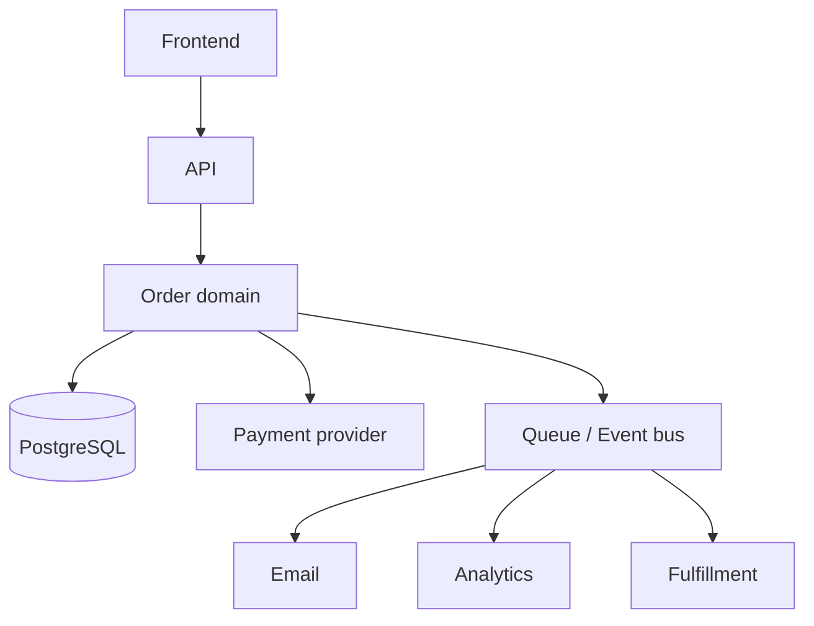

# System Design và Xử lý sự cố Production

## 1. Quy trình trả lời một bài system design

Sai lầm phổ biến nhất là bắt đầu bằng danh sách công nghệ: API Gateway, Lambda, DynamoDB, SQS, SNS. Interviewer không chấm việc bạn thuộc tên service, mà chấm việc bạn **đi từ yêu cầu tới thiết kế** và giải thích được vì sao.

Thứ tự nên đi:

1. **Functional requirements**: hệ thống phải làm được gì. Với order: tạo, huỷ, thanh toán, xem trạng thái.
2. **Non-functional requirements**: traffic, latency mục tiêu, availability, yêu cầu consistency, khối lượng dữ liệu, mức tăng trưởng, mức độ chấp nhận eventual consistency.
3. **API**: vài endpoint chính, đủ để thấy mô hình dữ liệu và luồng.
4. **Data model**: bảng chính, khoá, quan hệ, nơi cần transaction.
5. **Kiến trúc cơ bản**: client → API → domain → database, cộng async khi cần.
6. **Scale và failure**: chỉ sau khi có baseline mới nói cache, replica, partition, queue, rate limit, autoscaling.

Điểm quan trọng là **nêu giả định** trước khi thiết kế: "giả sử 1.000 order/phút, đọc nhiều hơn ghi 10 lần, không cần real-time analytics". Nhờ vậy mọi lựa chọn phía sau đều có căn cứ, và interviewer có thể điều chỉnh giả định để kiểm tra bạn.

Tránh overengineering ngay từ đầu. Nếu thiết kế một hệ thống mới cho vài nghìn user mà đã có 6 service, Kafka, DynamoDB và multi-region, bạn đang trả giá vận hành cho những vấn đề chưa tồn tại.

## 2. Thiết kế hệ thống đặt hàng

**Yêu cầu chức năng**: tạo order, giữ tồn kho, thanh toán, huỷ, theo dõi trạng thái.

**Yêu cầu phi chức năng**: không bán vượt tồn kho, không trừ tiền hai lần, có audit, availability cao, latency vừa phải cho thao tác đọc.

**Luồng cơ bản**:



Những điểm quyết định thiết kế:

- **Tồn kho**: trừ kho bằng atomic update có điều kiện (`UPDATE ... SET stock = stock - 1 WHERE stock > 0`) và kiểm tra số dòng ảnh hưởng, thay vì đọc rồi ghi.
- **Thanh toán**: idempotency key theo order, gửi xuống cả payment provider; trạng thái payment là nguồn sự thật cho việc xác nhận order.
- **Phát event**: dùng transactional outbox để order và event được commit cùng nhau, tránh mất event khi crash giữa hai lần ghi.
- **Consumer**: idempotent, có retry có backoff, DLQ cho message hỏng.
- **Đọc**: order vừa tạo được đọc từ database chính; danh sách order có thể dùng read replica hoặc cache nếu chấp nhận dữ liệu trễ vài giây.
- **Quan sát**: correlation ID xuyên suốt, structured log, metric theo endpoint, trace giữa API → domain → payment provider.

Một câu hỏi đào sâu hay gặp: "payment đã thành công nhưng order vẫn pending". Đây là bài toán **đồng bộ trạng thái giữa hai hệ thống** — cần webhook từ provider (có verify chữ ký, idempotent), cộng job đối soát định kỳ cho trường hợp webhook mất. Không thể chỉ dựa vào việc client gọi callback.

## 3. Latency đột nhiên tăng từ 200ms lên 5 giây, debug thế nào?

Không bắt đầu bằng "restart server". Làm theo thứ tự để thu hẹp phạm vi:

**Bước 1 — xác định blast radius**: toàn bộ endpoint hay một endpoint? Một region hay tất cả? Toàn bộ user hay một tenant? Từ lúc nào?

**Bước 2 — đối chiếu thay đổi gần đây**: deployment, migration, thay đổi hạ tầng, tăng traffic, thay đổi từ dependency bên ngoài.

**Bước 3 — nhìn golden signals**: latency (P50/P95/P99), traffic, error rate, saturation (CPU, memory, connection pool, queue depth). P50 bình thường mà P99 tăng thường là vấn đề tài nguyên hoặc lock; cả hai đều tăng thường là dependency chậm.

**Bước 4 — khoanh vùng theo trace**. Với một request chậm, trace cho biết thời gian nằm ở đâu:

```text
API Gateway        20 ms
Lambda             50 ms
Database           80 ms
Payment API      4700 ms
```

Ngay lập tức loại được nghi vấn về code của mình. Nếu không có tracing, so sánh metric giữa các tầng và log thời gian từng bước.

**Bước 5 — kiểm chứng giả thuyết bằng số liệu**, không bằng cảm giác. Ví dụ nghi connection storm: xem số connection tới DB, concurrency của Lambda, CPU của DB cùng một khoảng thời gian.

Sau khi xác định nguyên nhân: **mitigate trước, fix sau**. Mitigation có thể là rollback, giới hạn concurrency, bật cache, tăng timeout có kiểm soát, hoặc tạm chặn một endpoint. Root cause fix đến sau, kèm test và alert để không tái diễn.

## 4. Sau deploy, error rate tăng từ 0.1% lên 15%, làm gì?

Ưu tiên đầu tiên là **giảm ảnh hưởng tới người dùng**, không phải tìm nguyên nhân. Nếu deployment là mốc thời gian rõ ràng:

- Rollback bản trước, hoặc chuyển traffic về version cũ (với Lambda: alias và weighted routing).
- Xác nhận error rate trở lại bình thường.

Sau đó mới phân tích, trên môi trường an toàn:

- Log và trace của các request lỗi thuộc version mới.
- So sánh cấu hình, biến môi trường, migration, dependency version.
- Tái hiện trên staging hoặc bằng test viết mới.

Phân biệt rõ **mitigation và fix**: rollback không sửa được lỗi, nó chỉ mua thời gian. Fix thật có thể là bổ sung integration test, sửa chiến lược migration (backward compatible, deploy theo hai bước), thêm canary deployment, hoặc thêm alert để phát hiện sớm hơn.

Một điểm đáng nêu khi phỏng vấn: error rate 15% nhưng chỉ một endpoint lỗi thì có thể không cần rollback toàn bộ — tắt feature bằng feature flag sẽ ít rủi ro hơn. Chọn biện pháp mitigation theo phạm vi ảnh hưởng.

## 5. Case study: từ Lambda concurrency tới đơn hàng bị tạo hai lần

Đây là kiểu câu hỏi nối nhiều mảng kiến thức, và cũng là kịch bản rất thật.

Diễn biến:

1. Traffic tăng, Lambda scale lên hàng nghìn instance đồng thời.
2. Mỗi instance mở connection tới PostgreSQL, vượt khả năng của DB.
3. Query chậm, nhiều request vượt timeout.
4. API Gateway/SQS retry các request đã timeout.
5. Request được xử lý lại, và vì handler không idempotent, order bị tạo hai lần.
6. Một số payment đã trừ tiền nhưng event `OrderCreated` không được publish vì crash sau khi commit.

Chuỗi nhân quả:

```text
Lambda concurrency
  -> DB connection exhaustion
  -> timeout
  -> retry
  -> duplicate processing
  -> cần idempotency
  -> cần transaction/outbox
  -> cần queue + DLQ
  -> cần observability để thấy sớm
```

Cách trình bày khi phỏng vấn: không nhảy thẳng vào "dùng RDS Proxy". Đi theo thứ tự **phát hiện → khoanh vùng → nguyên nhân → biện pháp ngắn hạn → biện pháp dài hạn**:

- Ngắn hạn: giới hạn concurrency, rollback nếu có deploy, xử lý các order trùng đã phát sinh.
- Trung hạn: RDS Proxy, idempotency key ở API và consumer, unique constraint ở tầng DB để chặn trùng.
- Dài hạn: outbox cho event, DLQ cho consumer, alert trên DLQ depth và DB connection, trace xuyên suốt.

Điểm được chấm là khả năng nối các mảnh với nhau thành một hệ quả logic, thay vì coi mỗi công nghệ là kiến thức rời rạc.
